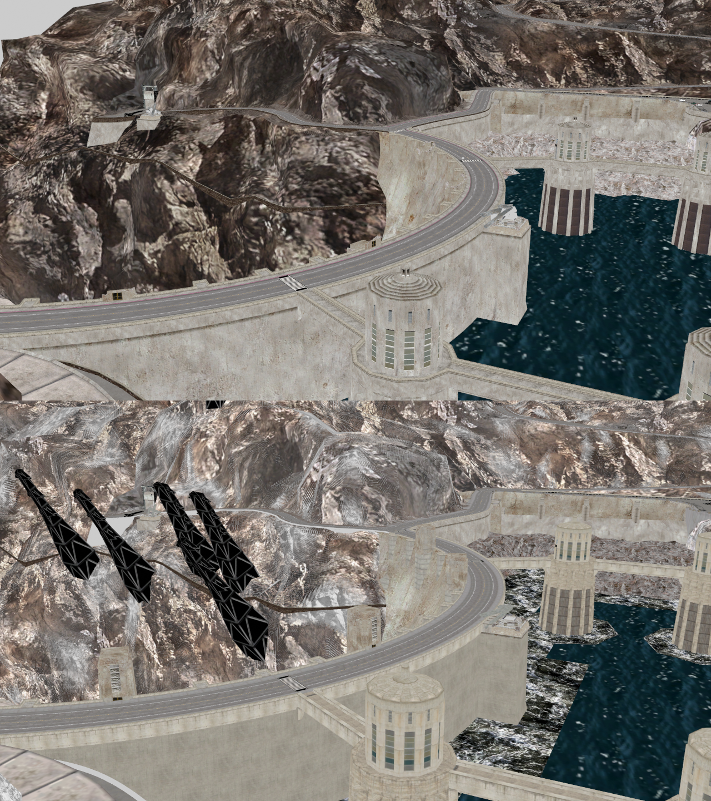
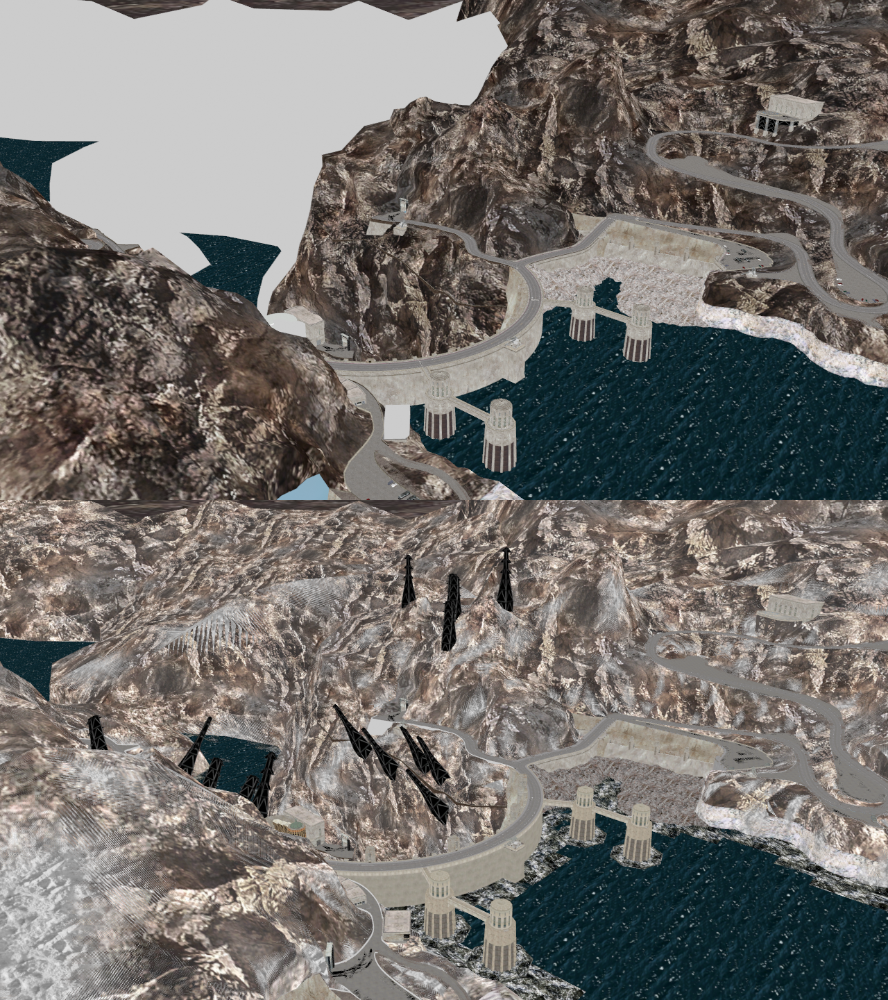

# Restoring a hi-res Hoover Dam exterior (HooverExt) on PC from the PS3 maps

The PC game ships without the Hoover Dam exterior level's map. The current PC map is converted from the Wii version
(low detail, see `WII_HOOVEREXT_NOTES.md`). This guide covers the next step: a **High Detail** HooverExt built from the
two maps left in the PS3 *Hoover Dam Edition* build, keeping each one's strengths and fixing each one's problems.

Status keys: ✅ works in game · 🔧 built and checked offline, not tested in game yet · ⏳ not started.

## The two PS3 maps
They are the only HooverExt maps in the PS3 build (`USRDIR\LEVELS\HOOVEREXT`). The Hoover Dam Edition mod calls them
"Low Detail" and "High Detail"; here they are the **early build** and the **updated build**.

| | Early build `HOOVEREXT_PS3.GSC` (1 file) | Updated build: `_MAIN`, `_BUILDINGS`, `_POS`, `_VEHICLES` (4 files) |
|---|---|---|
| Detail | 118k triangles, textures mostly 64–256 px (2.7 MB) | 457k triangles, textures up to 1024 px (~74 MB) |
| Mountains | clean, consistent rock | much more detail, but a streaky layered-texture glitch |
| Buildings | dam, intake towers, a few blocks; visitor centre bare | all 54 buildings, power pylons, parking structure, building system (destructible) |
| Lake by the dam | water covers it | lake bed shows through in patches |
| SAM sites | all 46 debris pieces + hatch doors (chapter 2 works) | 15 debris pieces, renamed so scripts can't find them; no hatch door |
| Out of bounds | none | falling off the dam kills / respawns; water not solid |

Renders from the same cameras (top = early, bottom = updated), made with the preview tools listed below:




The current PC (Wii-based) map looks like the early build. **The updated build is the hi-res base**; the early build
(and the Wii scene) supply the fixes.

## How the conversion works
`ps32pc.py` converts one PS3 scene file into a PC `.GSC`. It is a subclass of the Wii converter `wii2pc.py`, which is
proven in game. The PS3 display data has the Wii's layout (same header offsets, 8-byte command stream, 208-byte
instances, per-object tables, DNO2 collision version 15), so those writers are reused. Only these parts are PS3-specific:

| Part | PS3 | What the converter does |
|---|---|---|
| Container | `u32 nu20Rel, u32 nTex, nTex × {offset, size}`, offsets relative to the end of that table; NU20 block big-endian, tags byte-reversed, chunks 16-aligned (size excludes padding) | `PS3NU20` reader |
| Textures | TST0 68-byte records: +0x20 format (0x86 DXT1, 0x88 DXT5), +0x30 = 0x80000000 \| container index | copies the DXT data (byte-identical to PC) into DDS; reads alpha from the blocks |
| Materials | 1168 B – 16 KB records; index = order of the 0x80 command targets; +0x25C diffuse texture; byte +0x424 = 0x04 on opaque materials | rebuilt from a PC template (Tranquility lit 0x0909): opaque, alpha-test (cut-out alpha) or blended (soft alpha) |
| Geometry | 0xA0 draw records with up to 8 RSX vertex streams (float3 position, u8×4 normal, u8×4 colour, half2 UV), big-endian u16 triangle lists | decodes to PC stride-28 vertices; lists joined into one strip |
| Matrices | 4×4 row-vector, like PC (the Wii's are 3×4) | hook `draw_matrix_col` |
| 0x85 jumps | relative to the pointer field | hook `jump_index` = i + (rel + 4) / 8 |
| Materials of instanced objects | from the per-object tables (DISP+0x14), not the stream's 0x80 | as in `wii2pc` |

More format detail: `PS3_HOOVEREXT_NOTES.md`, `PC_GSC_FORMAT.md`.

### Things learned on the way
- **The PC engine draws every piece of an instanced object with the instance's matrix.** In all stock PC levels the
  0x83 matrix before each piece equals the instance matrix (~14,000 draws checked). The Wii data places some visitor-centre
  pieces with their own matrix, so they came out scattered; `wii2pc.instance_offsets()` bakes the offset into the vertices.
- **A level can load up to 8 scenes**, and extra `SCENE` lines load on both detail settings (scene loader 0x4A3BE0);
  the CURRGEN/NEXTGEN split only happens when `LEVEL.CFG` is parsed.
- **High Detail must be on** to load the NEXTGEN list: `Documents\ACTIVISION\Transformers\pcconfig.txt`
  `TransformersUseHires 1` (or the game's High Detail option).
- **Hiding without breaking templates:** the updated build's 15 renamed debris pieces share geometry with the
  `LO_girder*` prop templates, so `ps32pc.HIDE_INSTANCES` redirects only those objects' draw commands to an empty draw
  (`wii2pc` hook `hide_cmds`). The Wii scene still provides all 46 debris pieces under their real `LO_` names.

## Steps
Each step is tested in a lab copy of the game (`Lab - HooverExt`) with High Detail on. The lab's
`LEVELS\HOOVEREXT\LEVEL.CFG` NEXTGEN block lists the converted scenes next to the Wii-based `HooverExt`.

| # | Scene | Result | Status |
|---|---|---|---|
| 1 | `HooverExt_Vehicles` | 28 vehicle models, 73 materials, 49 textures, 83 draws; level loads, vehicles appear | ✅ |
| 2 | `HooverExt_POs` | 76 prop models, 141 textures, 102 draws; renamed debris hidden | 🔧 |
| 3 | `HooverExt_Main` (50 MB) | terrain + collision; layered terrain materials → PC hi-res terrain materials (or the early build's look) to fix the streaks | ⏳ |
| 4 | `HooverExt_Buildings` (24 MB) as `BUILDINGSCENE` | destructible buildings; drop the baked building collision in High Detail | ⏳ |
| 5 | fixes from the early build / Wii scene | 46 SAM debris pieces with `LO_A4C2…` names, `samsiteHatchDoor`, water by the dam, jetty platforms, visitor-centre well cap | ⏳ |

Once steps 3–5 work, the Wii-based scene leaves the NEXTGEN list: High Detail = the restored PS3 map, Low Detail = the
Wii-based map.

## Running it
Needs Python 3 with numpy (Blender's bundled Python works). From `Fresh Build\mods\wii_tools`:

```
python ps32pc.py "<PS3 build>\USRDIR\LEVELS\HOOVEREXT\HOOVEREXT_VEHICLES_PS3.GSC" HOOVEREXT_VEHICLES_PC.GSC --template-dir "<game>\LEVELS"
python pcgsc_check.py HOOVEREXT_VEHICLES_PC.GSC
python pc_dno2_check.py HOOVEREXT_VEHICLES_PC.GSC
```

The template folder needs the stock `FRONTEND`, `HOOVERINT` and `TRANQUILITY2` scenes. Copy the result into the game's
`LEVELS\HOOVEREXT\` and add `SCENE HooverExt_Vehicles` (etc.) to the NEXTGEN block of that folder's `LEVEL.CFG`.

Preview tools (`mods\ps3_tools`): `ps3_scene_json.py` exports whole PS3 scenes as the game draws them,
`map_render.py` renders them in Blender from fixed cameras, `pair.py` stacks two renders for comparison.

## In-game checks (High Detail, hooverExt)
- **Step 1:** the level loads; traffic and military vehicles appear. ✅ (2026-11-09)
- **Step 2:** the level loads; benches, lamp posts, signs, palm trees, handrails and boulders appear and can be picked
  up; SAM debris shows once at each SAM site, not doubled.
- After a crash, the newest `Transformers.exe.*.dmp` in `%LOCALAPPDATA%\CrashDumps` shows where it stopped.

## Related notes
- `HOOVEREXT_RESTORATION.md` – the full comparison of all three maps (Wii, early, updated) and the phase plan.
- `PS3_HOOVEREXT_NOTES.md` – PS3 scene format.
- `WII_HOOVEREXT_NOTES.md` – the Wii conversion the current PC map comes from.
- `MODLOG.md` (repo root) – dated entries for every step.
